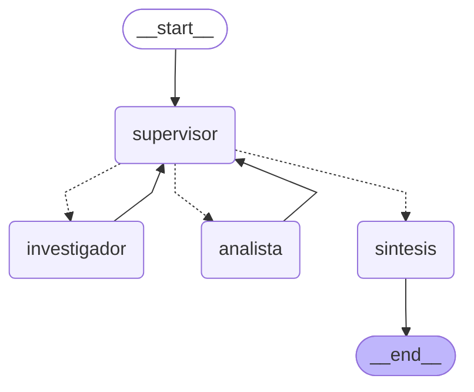
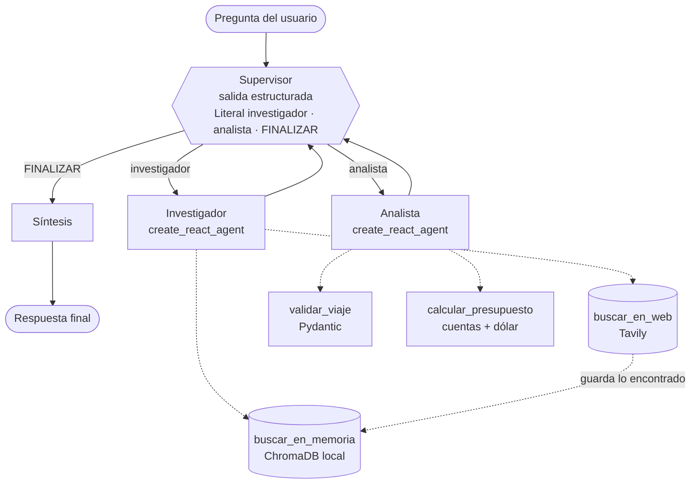

# Asesor de viajes multi-agente · Pre-entrega 6

> Curso AI Engineering · Coderhouse · Módulo 6 (Sistemas multi-agente: colaboración y especialización).
> Orquestador **jerárquico** en LangGraph: un **supervisor** coordina a un **investigador** (búsqueda web con Tavily + memoria local con ChromaDB) y a un **analista** (validación con Pydantic y cálculo de presupuesto), y una fase de **síntesis** arma la respuesta final.

Pregunta de demo:

> *"Quiero ir 7 días a Bariloche en enero, somos 2 personas, salimos desde Mendoza y tenemos 800.000 pesos. ¿Me armás el viaje y me decís si nos alcanza?"*

Esa pregunta necesita **dos dominios de especialización distintos**: conseguir datos actuales con fuente (precios de pasajes y alojamiento, clima, actividades, cotización del dólar) y procesarlos (validar el pedido y hacer las cuentas). Después hace falta una **síntesis**: el itinerario día por día, el presupuesto desglosado y las fuentes.

---

## Índice

1. [El grafo (diagrama Mermaid)](#1-el-grafo)
2. [Por qué una topología jerárquica](#2-por-qué-una-topología-jerárquica)
3. [Los agentes y sus herramientas](#3-los-agentes-y-sus-herramientas)
4. [Estado compartido (`state.py`)](#4-estado-compartido-statepy)
5. [El supervisor: rúbrica, reglas duras y frenos](#5-el-supervisor-rúbrica-reglas-duras-y-frenos)
6. [Cómo se manejan los conflictos entre agentes](#6-cómo-se-manejan-los-conflictos-entre-agentes)
7. [Contaminación de contexto](#7-contaminación-de-contexto)
8. [Tavily, ChromaDB y decisiones técnicas](#8-tavily-chromadb-y-decisiones-técnicas)
9. [Resultados: escenarios en vivo y en mock](#9-resultados-escenarios-en-vivo-y-en-mock)
10. [Lo que aprendimos de las corridas reales](#10-lo-que-aprendimos-de-las-corridas-reales)
11. [Cómo cumple cada criterio de evaluación](#11-cómo-cumple-cada-criterio-de-evaluación)
12. [Instalación y uso, paso a paso](#12-instalación-y-uso-paso-a-paso)
13. [Estructura del repositorio](#13-estructura-del-repositorio)
14. [Limitaciones conocidas](#14-limitaciones-conocidas)

---

## 1. El grafo

Diagrama generado por LangGraph con `graph.get_graph().draw_mermaid()` (podés regenerarlo con `python main.py --mock --mermaid`). Las flechas punteadas son las **aristas condicionales** que decide el supervisor:



El mismo grafo con las herramientas de cada especialista:



En código (`graph.py`):

```python
grafo = StateGraph(OrquestadorState)
grafo.add_node("supervisor", crear_nodo_supervisor(...))
grafo.add_node("investigador", crear_nodo_investigador(...))
grafo.add_node("analista", crear_nodo_analista(...))
grafo.add_node("sintesis", crear_nodo_sintesis(...))
grafo.add_edge(START, "supervisor")
grafo.add_conditional_edges("supervisor", ruta_supervisor,
                            {"investigador": "investigador", "analista": "analista", "sintesis": "sintesis"})
grafo.add_edge("investigador", "supervisor")
grafo.add_edge("analista", "supervisor")
grafo.add_edge("sintesis", END)
```

`ruta_supervisor` devuelve `Literal["investigador", "analista", "sintesis"]`: traduce la decisión del supervisor (`FINALIZAR` → `sintesis`) al nombre del nodo siguiente.

---

## 2. Por qué una topología jerárquica

| Alternativa | Por qué no |
|---|---|
| **Cadena fija** (investigador → analista → síntesis) | No puede saltear pasos (una pregunta solo de clima no necesita al analista), ni repetir uno cuando el resultado no sirve (una búsqueda sin precios). |
| **Red de agentes que se hablan entre sí** | Nadie es responsable de cortar: es justo donde aparece el "supervisor infinito" o los agentes que se corrigen mutuamente sin fin. Además, cada agente necesitaría conocer a los demás. |
| **Jerárquica (la elegida)** | Un solo punto de decisión. Los especialistas solo hacen su trabajo y le devuelven el control al supervisor, que **valida con una rúbrica** antes de seguir o de terminar. |

Ventajas concretas en este proyecto:

- **Delegación dinámica:** la ruta depende de la pregunta y de lo que va saliendo. Por ejemplo: "¿qué clima hace?" → solo investigador; "¿nos alcanza?" → investigador y analista; búsqueda sin precios → investigador de nuevo.
- **Un único lugar para validar y frenar:** la rúbrica, las reglas duras y el contador de pasos viven en el supervisor.
- **Especialistas simples y reemplazables:** cada uno tiene **solo sus herramientas**. Si mañana el investigador usa otra fuente, el resto no cambia.
- **Trazabilidad:** cada decisión queda registrada con su evaluación de la rúbrica (`decisiones` en el estado y en las trazas).

---

## 3. Los agentes y sus herramientas

| Agente | Archivo | Qué hace | Herramientas (solo estas) | Qué recibe |
|---|---|---|---|---|
| **Supervisor** | `agents/supervisor.py` | La primera vez extrae el pedido (`PedidoViaje`). En cada turno decide quién trabaja, qué tiene que hacer y qué temas buscar, o si se termina. | Ninguna (salida estructurada) | La pregunta, el pedido, la **cobertura por tema** calculada por código y un resumen de cada aporte con las observaciones del chequeo |
| **Investigador** | `agents/research_agent.py` | Consigue datos actuales con fuente: pasajes, alojamiento, comida, clima, actividades y dólar. Busca primero en la memoria y va a la web solo si hace falta. | `buscar_en_memoria`, `buscar_en_web` (`agents/research_tools.py`) | Su instrucción + `TEMAS A BUSCAR` + `DATOS DEL PEDIDO` |
| **Analista** | `agents/analyst_agent.py` | Valida el viaje y calcula el presupuesto; si no alcanza, calcula una alternativa. No busca datos. | `validar_viaje`, `calcular_presupuesto` (`agents/analyst_tools.py`) | Su instrucción + `DATOS DEL PEDIDO` + el texto final de los hallazgos del investigador |
| **Síntesis** | `agents/synthesizer.py` | Escribe la respuesta: itinerario día por día, presupuesto desglosado, alternativas y lo que no se pudo averiguar. | Ninguna | La pregunta, el pedido y los aportes validados |

Los dos especialistas son agentes ReAct armados con **`create_react_agent`** de LangGraph, con su propio ciclo (pensar → herramienta → observar) y su propio techo de pasos.

### Herramientas del investigador

- **`buscar_en_memoria(consulta, destino, tema)`** consulta la memoria local (ChromaDB). Un dato guardado sirve solo si pasa **tres filtros**:
  1. mismo destino y tema (filtro por metadatos);
  2. buscado hace **7 días o menos** (`MEMORIA_MAX_DIAS`, filtro por metadatos sobre la fecha);
  3. parecido a la consulta: distancia coseno ≤ 0,55. El umbral está calibrado con el modelo real: las consultas parecidas dieron 0,24–0,44 y las de otro tema, 0,64–0,72.

  Si ninguno pasa, responde `SIN RESULTADOS EN MEMORIA` y explica por qué (vencido, poco parecido o nada guardado).
- **`buscar_en_web(consulta, destino, tema, forzar)`** busca con Tavily y **guarda todo en la memoria**, con destino, tema, URL y fecha. Tiene una guarda por código: si la memoria ya tiene datos vigentes, no gasta una búsqueda. `forzar=true` permite ir igual a la web **solo si lo guardado no trae precios**; si los trae, también se bloquea.

Las dos devuelven texto para el LLM **y** la lista de `Fuente` (Pydantic) como *artifact*. El aporte del investigador se arma con esas fuentes, no con lo que diga el LLM: **las URLs no se pueden inventar**.

### Herramientas del analista (determinísticas, sin LLM adentro)

- **`validar_viaje`** aplica el modelo Pydantic `ViajeValidado`:
  - origen y destino distintos;
  - **vuelta después de la ida**;
  - ida en el futuro;
  - como máximo 60 días;
  - las fechas coinciden con los días pedidos;
  - 1 a 20 personas, presupuesto positivo y moneda ARS o USD.

  Junta **todos** los errores juntos, para que el usuario corrija todo de una vez.
- **`calcular_presupuesto`** suma, renglón por renglón y mostrando la fórmula de cada uno:
  - pasajes por persona (×2 si el precio es por tramo);
  - alojamiento: la **unidad es obligatoria**. Por habitación: precio × noches × habitaciones (redondeadas para arriba). Por persona: precio × noches × personas. Nunca se aplican las dos;
  - comida y actividades por persona por día;
  - extras.

  Si hay precios en otra moneda, convierte e **informa qué dólar usó y de qué fuente salió**: con tarjeta, el **dólar tarjeta**; en efectivo, el **MEP** (y, si no está, el oficial). Si falta la cotización necesaria, devuelve un error claro en vez de inventarla. Al final dice si **entra o no**, cuánto sobra o falta y el costo por día y por persona.

---

## 4. Estado compartido (`state.py`)

```python
class OrquestadorState(MessagesState):          # hereda literalmente de MessagesState
    pregunta: str
    pedido: PedidoViaje | None                   # lo escribe el supervisor UNA vez
    aportes: Annotated[list[Aporte], operator.add]          # se SUMAN, nunca se pisan
    pasos_supervisor: int                        # contador del freno
    siguiente: Literal["investigador", "analista", "FINALIZAR"]
    instruccion_actual: str
    temas_pedidos: list[Tema]                    # temas que tiene que buscar el investigador
    decisiones: Annotated[list[DecisionRegistrada], operator.add]
    respuesta_final: str
```

- **Quién aportó qué información:** cada intervención de un especialista queda como un `Aporte`, un modelo Pydantic con `extra="forbid"` y `frozen=True`. Registra el agente, la ronda, la instrucción que recibió, su contenido, sus **fuentes** (`Fuente`: URL o ID de memoria, si salió de la **memoria** o de la **web**, el tema y la fecha), cada **llamada a herramienta** con sus argumentos y resultado, la **cobertura por tema** y las **observaciones** del chequeo por código.
- **Validación Pydantic estricta:** los IDs de memoria tienen formato `mem-` + 12 caracteres hexadecimales, las URLs se validan, un especialista **no puede figurar usando herramientas de otro rol** y el supervisor no puede delegar sin instrucción, ni mandar al investigador sin temas.
- **Cada agente escribe solo su parte:** `validar_actualizacion(nodo, ...)` revisa todo lo que devuelve cada nodo antes de que entre al estado. Si el investigador intenta tocar `siguiente`, o firmar un aporte como "analista", da error (`ErrorDeEstado`). Hay tests para cada caso.
- **`PedidoViaje` no valida reglas de negocio, a propósito:** guarda lo que dijo el usuario, aunque sea imposible. Si validara "vuelta después de la ida", un pedido mal hecho ni siquiera se podría registrar y nadie le avisaría al usuario qué corregir. Esa validación la hace `validar_viaje`.

---

## 5. El supervisor: rúbrica, reglas duras y frenos

**Salida estructurada.** El LLM está obligado a responder con `DecisionSupervisor`:

```python
class DecisionSupervisor(BaseModel):
    evaluacion: str                                        # repasa la rúbrica punto por punto
    siguiente: Literal["investigador", "analista", "FINALIZAR"]
    instruccion: str                                       # autocontenida: el especialista no ve la pregunta
    temas: list[Tema]                                      # obligatoria si va al investigador
```

**Rúbrica de su prompt.** Para FINALIZAR se tienen que cumplir todos estos puntos:

| | Punto | Qué exige |
|---|---|---|
| R1 | Cobertura | cada parte de la pregunta tiene datos |
| R2 | Fuentes | cada aporte del investigador tiene URL o `mem-…` |
| R3 | Precios | pasajes y alojamiento tienen al menos un monto de referencia (no exactos por fecha) |
| R4 | Cálculo | si hay presupuesto, el analista validó y calculó |
| R5 | Observaciones | no quedan observaciones del chequeo por código sin resolver; si las hay, se devuelve el trabajo al **mismo** especialista con la corrección exacta |
| R6 | Coherencia | no hay contradicciones entre aportes |

**Validación por código.** Para no depender solo del criterio del LLM:

1. **Chequeo de cada especialista**, que anota `observaciones`:
   - *investigador:* no usó herramientas, no hay fuentes, falló la web, un tema pedido no se buscó, pasajes o alojamiento sin precios, no cita sus fuentes;
   - *analista:* no validó, validó pero no calculó, una herramienta dio error, no dice si entra.
2. **Cobertura por tema**, calculada por código: fuentes, cuántas de memoria y cuántas de la web, y si hay precios. El supervisor la ve como tabla antes que los textos.
3. **Reglas duras** que corrigen decisiones imposibles:
   - analista sin datos del investigador → investigador;
   - FINALIZAR sin ningún aporte → investigador;
   - **FINALIZAR con presupuesto y sin el cálculo del analista → analista** (R4 por código);
   - el investigador trabaja como máximo 2 veces (la búsqueda original + una corrección);
   - **pedido imposible** (`validar_viaje` rechazó las fechas del usuario) → no se vuelve al analista ni se suponen otras fechas: FINALIZAR.
4. **Respaldo:** si el LLM devuelve dos veces una decisión inválida, decide por reglas fijas y lo anota.

**Frenos contra el "supervisor infinito".** Son tres, de afuera hacia adentro:

| Freno | Valor | Qué hace |
|---|---|---|
| `MAX_PASOS_SUPERVISOR` | 6 | La decisión número 6 es **siempre FINALIZAR, forzado por código**, sin preguntarle al LLM. La síntesis avisa que la información es parcial (escenario 8). |
| `RECURSION_LIMIT` | 20 | Techo de LangGraph para el grafo principal. Si se supera, la corrida termina con un aviso controlado. |
| `RECURSION_LIMIT_ESPECIALISTA` | 12 | Techo del ciclo ReAct de cada especialista. Si se corta, se rescata lo que alcanzó a hacer y queda anotado. |

---

## 6. Cómo se manejan los conflictos entre agentes

1. **Los especialistas no se hablan entre ellos.** No pueden discutir ni corregirse mutuamente: todo pasa por el supervisor, que tiene la última palabra.
2. **El supervisor arbitra con la rúbrica y con datos objetivos.** No depende de "quién suena más convincente": ve las observaciones del chequeo por código y la cobertura por tema. Si un aporte tiene problemas, se lo devuelve **al mismo especialista** con una instrucción que dice exactamente qué corregir. Por ejemplo: *"rehacer la búsqueda de pasajes con forzar=true porque no trajo precios"*.
3. **Cada dato tiene dueño y procedencia.** Los aportes se acumulan (nunca se pisan) y cada uno dice quién lo hizo, con qué instrucción y de qué fuente salió. Si dos aportes no coinciden, se ve de dónde viene cada versión.
4. **Los números los decide una herramienta, no un LLM.** Si el investigador trae precios distintos, el analista los pasa por `calcular_presupuesto` y la síntesis **copia** ese resultado, sin recalcular. Si las fuentes se contradicen (pasó con el clima en vivo: una decía máximas de 19 °C y otra de 28 °C), la síntesis lo dice en vez de elegir una en silencio.
5. **Desacuerdos que no se resuelven:** con como máximo una corrección por especialista y el freno de pasos, el sistema siempre termina. La síntesis aclara qué faltó ("Lo que no pudimos averiguar").
6. **Nadie puede escribir lo de otro:** `validar_actualizacion` bloquea, por código, que un nodo modifique campos ajenos o firme como otro.

---

## 7. Contaminación de contexto

Ningún especialista recibe el historial ni la pregunta original:

- **Investigador:** su instrucción + `TEMAS A BUSCAR` + `DATOS DEL PEDIDO` (origen, destino, fechas, personas y presupuesto, armados por código desde `PedidoViaje`).
- **Analista:** lo mismo + **solo el texto final** de los hallazgos del investigador. No ve sus búsquedas internas ni los resultados crudos de Tavily.
- **Supervisor:** resúmenes de cada aporte (no las llamadas internas) + la tabla de cobertura.

Así **no se depende de que el supervisor se acuerde de copiar todos los datos en la instrucción**, y cada agente ve lo mínimo necesario. Hay tests que lo verifican: meten un "SECRETO" en el historial y la pregunta original marcada, y comprueban que ningún especialista los ve (`test_contexto_acotado_*`).

---

## 8. Tavily, ChromaDB y decisiones técnicas

### Qué es Tavily y por qué la web es la fuente correcta para viajes

**Tavily** es un buscador web pensado para agentes de IA. Devuelve resultados ya limpios (título, URL y extracto de contenido) en vez de páginas HTML, así que el LLM puede leerlos directo.

Para un viaje, **la web es la única fuente razonable**: los precios de pasajes y alojamiento, la cotización del dólar y las tarifas de excursiones cambian todo el tiempo. Una base de documentos propia (como el Pinecone de las pre-entregas anteriores) quedaría desactualizada enseguida. Por eso cada dato lleva su **URL y su fecha de búsqueda**, y la respuesta aclara que los precios son aproximados.

### `langchain-tavily` en lugar de `TavilySearchResults`

La consigna nombra `TavilySearchResults` (de `langchain-community`). Esa clase está **deprecada**; su reemplazo oficial es **`TavilySearch`**, del paquete **`langchain-tavily`**, que es el que se usa acá (`agents/research_tools.py`, clase `BuscadorTavily`). La función es la misma: buscar en la web y devolver resultados con URL.

### Por qué ChromaDB y no Pinecone para la memoria

| | ChromaDB (elegido) | Pinecone (pre-entregas 4 y 5) |
|---|---|---|
| Dónde vive | Local, en `data/memoria_chroma/` | Servicio en la nube |
| Claves | Ninguna | API key |
| Uso | Memoria de **una** persona en **su** máquina | Pensado para índices grandes y compartidos |
| Evaluación | **El evaluador lo puede correr** sin cuentas ni claves (modo mock) | Necesitaría nuestra clave |

La memoria es un caché de búsquedas web con vencimiento de 7 días, no una base de conocimiento: no hace falta un servicio administrado. Además se usan los embeddings ONNX que trae ChromaDB por defecto (all-MiniLM-L6-v2, **sin torch**, unos 80 MB que se descargan una sola vez). En modo mock y en los tests se usa un embedding por hashing que no descarga nada.

### `create_react_agent`

La consigna pide `create_react_agent` de LangGraph y se usa tal cual. En LangGraph 1.x esa función sigue funcionando, pero muestra un aviso de que el reemplazo nuevo es `create_agent` (de `langchain.agents`). Se mantuvo el nombre literal de la consigna y el aviso se silencia en `pytest.ini`.

### Otras decisiones

- **Asíncrono de punta a punta:** todos los nodos son `async`, las herramientas son corrutinas y lo bloqueante (ChromaDB) corre en `asyncio.to_thread`. Se usan `ainvoke` y `astream`. La consigna no lo exige; se eligió porque las búsquedas en paralelo del investigador lo aprovechan.
- **Claude vía `ChatAnthropic`:** `claude-haiku-5-5`, con `effort="low"` en lugar de `temperature` (la API actual no acepta `temperature` en los modelos nuevos), 3 reintentos y un tope de 8000 tokens de salida (ver sección 10).
- **Modo mock:** un `LLMMock` cuyas "políticas" por rol **reaccionan** a lo que devuelven las herramientas reales (memoria, validación, cálculo), más un Tavily simulado con datos ficticios en `data/mock_busquedas.json` (dominio reservado `.example`). **El grafo es el mismo** que en vivo.
- **Fuentes y avisos los agrega el código:** la síntesis no puede inventar URLs. La lista final muestra solo las fuentes citadas, sin repetir la misma página como "web" y "memoria".

---

## 9. Resultados: escenarios en vivo y en mock

`python escenarios.py` corre los 8 escenarios y arma [`traces/resultados.md`](traces/resultados.md) **leyendo las trazas guardadas**: cada fila tiene su evidencia en `traces/`. Cada traza viene en dos formatos: `.json` (estructurado) y `.log` (legible, con cada decisión del supervisor, su evaluación de la rúbrica, cada llamada a herramienta y la cobertura por tema).

| # | Escenario | Qué demuestra |
|---|---|---|
| 1 | Flujo completo (pregunta de demo) | Delegación supervisor → investigador → analista → síntesis |
| 2 | "¿Qué clima hace en Bariloche en enero?" | El supervisor **no** llama al analista si no hace falta |
| 3 | Presupuesto de $400.000 | El analista detecta que no alcanza y calcula una alternativa |
| 4 | "Del 16 al 10 de enero" | `validar_viaje` rechaza la vuelta antes de la ida; no se arma itinerario |
| 5 | La pregunta del 1, otra vez | Los datos salen de la memoria (ChromaDB) |
| 6 | "¿Cómo llegar… y cuánto sale el pasaje?" | El supervisor rechaza una búsqueda sin precios y pide rehacerla |
| 7 | Tavily caído (solo mock) | La herramienta devuelve el error, el flujo termina y avisa qué faltó |
| 8 | `max_pasos=2` | El freno fuerza FINALIZAR y la respuesta avisa que es parcial |

| # | Escenario | Modo | Ruta del supervisor | Decisiones | Refin. | Validación | ¿Entra? | Datos (memoria · web) | Búsquedas web | Traza |
|---|---|---|---|---|---|---|---|---|---|---|
| 1 | flujo completo | real | sup → inv → sup → ana → sup → síntesis | 3 | 0 | aprobada | no | 0 · 18 | 6 | [1_flujo_completo_real_20261110-150904.json](traces/1_flujo_completo_real_20261110-150904.json) |
| 1 | flujo completo | mock | sup → inv → sup → ana → sup → síntesis | 3 | 0 | aprobada | sí | 0 · 6 | 5 (simuladas) | [1_flujo_completo_mock_20261110-151409.json](traces/1_flujo_completo_mock_20261110-151409.json) |
| 2 | solo clima | real | sup → inv → sup → síntesis | 2 | 0 | no se validó | — | 3 · 0 | 0 | [2_solo_clima_real_20261110-151106.json](traces/2_solo_clima_real_20261110-151106.json) |
| 2 | solo clima | mock | sup → inv → sup → síntesis | 2 | 0 | no se validó | — | 1 · 0 | 0 (simuladas) | [2_solo_clima_mock_20261110-151410.json](traces/2_solo_clima_mock_20261110-151410.json) |
| 3 | no alcanza | real | sup → inv → sup → ana → sup → síntesis | 3 | 0 | aprobada | no | 17 · 0 | 0 | [3_no_alcanza_real_20261110-151120.json](traces/3_no_alcanza_real_20261110-151120.json) |
| 3 | no alcanza | mock | sup → inv → sup → ana → sup → síntesis | 3 | 0 | aprobada | no | 6 · 0 | 0 (simuladas) | [3_no_alcanza_mock_20261110-151410.json](traces/3_no_alcanza_mock_20261110-151410.json) |
| 4 | fechas invalidas | real | sup → inv → sup → ana → sup → síntesis | 3 | 0 | rechazada | — | 15 · 0 | 0 | [4_fechas_invalidas_real_20261110-151218.json](traces/4_fechas_invalidas_real_20261110-151218.json) |
| 4 | fechas invalidas | mock | sup → inv → sup → ana → sup → síntesis | 3 | 0 | rechazada | — | 6 · 0 | 0 (simuladas) | [4_fechas_invalidas_mock_20261110-151410.json](traces/4_fechas_invalidas_mock_20261110-151410.json) |
| 5 | memoria | real | sup → inv → sup → ana → sup → síntesis | 3 | 0 | aprobada | no | 17 · 0 | 0 | [5_memoria_real_20261110-151006.json](traces/5_memoria_real_20261110-151006.json) |
| 5 | memoria | mock | sup → inv → sup → ana → sup → síntesis | 3 | 0 | aprobada | sí | 6 · 0 | 0 (simuladas) | [5_memoria_mock_20261110-151409.json](traces/5_memoria_mock_20261110-151409.json) |
| 6 | refinamiento | real | sup → inv → sup → inv → sup → síntesis | 3 | 1 | no se validó | — | 6 · 0 | 0 | [6_refinamiento_real_20261110-151258.json](traces/6_refinamiento_real_20261110-151258.json) |
| 6 | refinamiento | mock | sup → inv → sup → inv → sup → síntesis | 3 | 1 | no se validó | — | 2 · 1 | 1 (simuladas) | [6_refinamiento_mock_20261110-151410.json](traces/6_refinamiento_mock_20261110-151410.json) |
| 7 | tavily falla | mock | sup → inv → sup → inv → sup → ana → sup → síntesis | 4 | 1 | aprobada | — | 0 · 0 | 6 (simuladas) | [7_tavily_falla_mock_20261110-151410.json](traces/7_tavily_falla_mock_20261110-151410.json) |
| 8 | freno de pasos | real | sup → inv → sup → síntesis | 2 (freno) | 0 | no se validó | — | 17 · 0 | 0 | [8_freno_de_pasos_real_20261110-151330.json](traces/8_freno_de_pasos_real_20261110-151330.json) |
| 8 | freno de pasos | mock | sup → inv → sup → síntesis | 2 (freno) | 0 | no se validó | — | 6 · 0 | 0 (simuladas) | [8_freno_de_pasos_mock_20261110-151410.json](traces/8_freno_de_pasos_mock_20261110-151410.json) |

**Cómo leer la tabla:** "Datos (memoria · web)" son las fuentes distintas que usó el investigador; "Búsquedas web" son las llamadas reales a Tavily (en mock, simuladas). El escenario 1 corrió con la memoria vacía y los siguientes reutilizan lo que guardó: por eso del 2 en adelante casi no hay búsquedas en Tavily.

**Pregunta de demo en vivo (escenario 1):** el supervisor delegó al investigador (6 búsquedas en Tavily, 18 fuentes), después al analista (`validar_viaje` → VÁLIDO; `calcular_presupuesto`) y finalizó. Resultado: **no alcanza por poco: total $826.720 contra $800.000 (faltan $26.720)**, con itinerario día por día, alternativas y fuentes. La respuesta completa está en [`traces/1_flujo_completo_real_*.log`](traces/).

**Notas por escenario:**

- **5 · memoria:** en vivo, la segunda vez salieron **17 datos de la memoria y 0 búsquedas en Tavily** (antes de los arreglos del §10 todavía forzaba 3 búsquedas).
- **4 · fechas inválidas:** `validar_viaje` rechazó "del 16 al 10"; la síntesis explica el error y pide corregir la fecha, sin itinerario ni presupuesto.
- **6 · refinamiento:** en vivo el supervisor **rechazó el primer aporte** porque cubría el micro pero no tenía precios de vuelos, y pidió rehacerlo con `forzar`. Como la memoria ya tenía precios del tema "pasajes" (los del micro), el bloqueo de `forzar` no lo dejó ir a la web y la segunda ronda no agregó datos (ver §14). En mock, el rechazo por "búsqueda sin precios" y la nueva búsqueda se ven completos.
- **7 · Tavily caído (solo mock):** el investigador devuelve el error, el supervisor reintenta una vez, el analista valida el viaje pero **no inventa un presupuesto sin precios** (¿entra? = —) y la síntesis lista "Lo que no pudimos averiguar".
- **8 · freno:** la decisión 2 es FINALIZAR **forzado por código** y la respuesta empieza con el aviso de información parcial.

Las trazas de antes de cada arreglo quedaron en [`traces/anteriores/`](traces/anteriores/), para comparar.

---

## 10. Lo que aprendimos de las corridas reales

Las primeras corridas en vivo mostraron problemas que el modo mock no podía mostrar. Cada uno quedó corregido **por código y con test**, y las trazas de antes del arreglo están en [`traces/anteriores/`](traces/anteriores/).

| Corrida | Qué pasó | Qué se cambió |
|---|---|---|
| [`0_primera_corrida_real_antes_del_ajuste`](traces/anteriores/) | El supervisor pidió tres veces "precios exactos por fecha" (la web no los publica) y **finalizó sin pasar por el analista**, en contra de su propia rúbrica. Respuesta: "no podemos confirmar", con 75 fuentes. | Rúbrica con precios **de referencia**; regla dura "no se finaliza con presupuesto sin el analista"; como máximo 2 rondas del investigador; solo se listan las fuentes citadas; como máximo una búsqueda web por tema. |
| [`0b_segunda_corrida_real_tope_de_tokens`](traces/anteriores/) | Las llamadas a `calcular_presupuesto` llegaban vacías (`kwargs {}`) y la síntesis quedaba cortada. Causa: el tope de 2500 tokens de salida. El chequeo por código lo detectó y el supervisor devolvió el trabajo. | Tope de 8000 tokens; el analista calcula una opción por vez; síntesis más breve; aviso si igual se corta. |
| Escenario 5 (primera versión) | Con la memoria llena, el investigador **igual forzó 3 búsquedas en Tavily** (aunque lo guardado tenía precios); el supervisor veía el informe cortado y volvió a pedir temas ya cubiertos; y el chequeo leyó "no repitas pasajes" como si se pidiera buscar pasajes. | `forzar` **bloqueado por código** si la memoria tiene precios vigentes; **tabla de cobertura por tema** calculada por código para el supervisor; campo estructurado `temas` en la decisión (el chequeo usa ese campo, no palabras sueltas). |
| Escenario 4 (primera versión) | Con "del 16 al 10 de enero", `validar_viaje` rechazó el pedido, pero el **supervisor le pidió al analista que supusiera otra fecha** (vuelta el 22) y la métrica figuró como "validación aprobada". La respuesta final igual fue correcta (pedía corregir las fechas), pero con dos vueltas de más del analista. | La validación que cuenta es la **del pedido real** (`validacion_del_pedido`), no la de fechas supuestas; regla dura "pedido inválido → no se vuelve al analista, se finaliza"; el analista no puede inventar fechas. |
| Itinerario en vivo | Repitió "Cerro Catedral" en dos días. | Chequeo por código de lugares repetidos en la síntesis: pide **una** corrección al LLM y, si sigue, avisa. Se activó en vivo y la corrección salió sin repeticiones. |

---

## 11. Cómo cumple cada criterio de evaluación

| Criterio (peso) | Qué se pide | Dónde está |
|---|---|---|
| **Documentación y visualización (20 %)** | Explicar la topología y mostrar el grafo | Este README: diagrama Mermaid generado por LangGraph y diagrama con herramientas (§1), por qué jerárquica (§2), conflictos (§6), escenarios y resultados (§9–10), instalación (§12). `demo.ipynb` ejecutado con sus salidas. Trazas `.log` legibles. |
| **Arquitectura y flujo del grafo, supervisor (35 %)** | `StateGraph`, nodo supervisor con delegación dinámica, `Literal` en las aristas condicionales, condición de parada | `graph.py` (`StateGraph`, `add_conditional_edges`); `agents/supervisor.py`: `ruta_supervisor() -> Literal[...]`, `DecisionSupervisor.siguiente: Literal[...]`, rúbrica R1–R6, 5 reglas duras, freno `MAX_PASOS_SUPERVISOR` + `RECURSION_LIMIT`. Rutas distintas según la pregunta (escenarios 1, 2, 4, 6 y 8). Tests: `test_supervisor.py`, `test_graph.py`. |
| **Especialización de agentes y herramientas (25 %)** | Al menos 2 especialistas con herramientas funcionales y acotadas | Investigador (`buscar_en_memoria` + `buscar_en_web` con Tavily real) y analista (`validar_viaje` + `calcular_presupuesto`, determinísticas); los dos con `create_react_agent`. Cada rol solo puede usar sus herramientas (validado en `Aporte`). Tests: `test_research_tools.py`, `test_analyst_tools.py`, `test_research_agent.py`, `test_analyst_agent.py`, `test_memory.py`. |
| **Gestión de estado y validación (20 %)** | `state.py` coherente y mecanismos de validación | `OrquestadorState(MessagesState)` con aportes y decisiones acumulativos y modelos Pydantic estrictos; `validar_actualizacion` (cada nodo escribe solo su parte); chequeo por código de cada especialista; rúbrica + reglas duras del supervisor; chequeo de actividades repetidas en la síntesis. Tests: `test_state.py`, `test_synthesizer.py`. |

**Puntos de las devoluciones anteriores (MEJORAS_TICHER.md):**

- **Nombres literales:** `MessagesState`, `StateGraph`, `add_conditional_edges`, `create_react_agent`, `Literal`, y los archivos `state.py`, `agents/research_agent.py`, `agents/analyst_agent.py`, `graph.py` y `main.py`.
- **Tests con pytest y LLM mockeado, sin claves:** 128 tests (ver §12).
- **Modo mock:** `--mock`.
- **Evidencia de las corridas reales en el repo:** trazas y `demo.ipynb` ejecutado.
- **Instalación desde cero:** probada en un entorno limpio (§12).
- **Casos límite:** escenarios 2–8.
- **Resultados medidos:** tabla del §9.

---

## 12. Instalación y uso, paso a paso

Requisitos: **Python 3.12** y Windows, macOS o Linux. En Windows (PowerShell):

```powershell
# 1. Clonar y entrar
git clone https://github.com/anukvilarasau/pre-entrega-6.git
cd pre-entrega-6

# 2. Crear y activar el entorno virtual con Python 3.12
py -3.12 -m venv .venv
.venv\Scripts\Activate.ps1          # macOS/Linux: python3.12 -m venv .venv && source .venv/bin/activate

# 3. Instalar las dependencias (versiones fijas)
python -m pip install -r requirements.txt

# 4. Correr los tests (no necesitan claves): tienen que pasar los 128
python -m pytest -q

# 5. Probar el sistema SIN claves (modo mock)
python main.py --mock "Quiero ir 7 días a Bariloche en enero, somos 2 personas, salimos desde Mendoza y tenemos 800.000 pesos. ¿Me armás el viaje y me decís si nos alcanza?"
```

Para usarlo **con Claude y Tavily de verdad**:

```powershell
# 6. Crear el .env a partir de la plantilla y pegar las claves
copy .env.example .env               # macOS/Linux: cp .env.example .env
#    ANTHROPIC_API_KEY=...   (https://console.anthropic.com)
#    TAVILY_API_KEY=...      (https://app.tavily.com, el plan gratis alcanza)

# 7. Una pregunta, un chat o los escenarios
python main.py "Quiero ir 7 días a Bariloche en enero, somos 2 personas, salimos desde Mendoza y tenemos 800.000 pesos. ¿Me armás el viaje y me decís si nos alcanza?"
python main.py --chat                # varias preguntas seguidas; 'salir' para terminar
python escenarios.py                 # los 8 escenarios en vivo (el 7 en mock) + traces/resultados.md
```

Otras opciones de `main.py`:

| Opción | Qué hace |
|---|---|
| `--mock` | Sin claves: LLM y Tavily simulados, memoria en una carpeta temporal |
| `--chat` | Modo interactivo; cada respuesta muestra la ruta del supervisor y cuántos datos salieron de la memoria y cuántos de la web |
| `--max-pasos N` | Baja el freno del supervisor (escenario 8) |
| `--fallar-web` | (solo mock) simula Tavily caído |
| `--mermaid` | Imprime el diagrama del grafo |
| `-v` | Muestra los logs de cada etapa |

El notebook se reejecuta con `python -m jupyter nbconvert --to notebook --execute --inplace demo.ipynb`. Sin claves, corre solo las partes mock.

> El archivo `.env` está en `.gitignore`: **las claves nunca se suben a GitHub**. La memoria local (`data/memoria_chroma/`) tampoco.

---

## 13. Estructura del repositorio

```
pre-entrega-6/
├── state.py                 # OrquestadorState(MessagesState) + modelos Pydantic + validar_actualizacion
├── graph.py                 # StateGraph jerárquico + consultar() (corre una pregunta y guarda la traza)
├── main.py                  # CLI: una pregunta, --chat, --mock, --max-pasos, --mermaid
├── config.py                # claves (.env), rutas, frenos, modo mock
├── llm.py                   # Claude (ChatAnthropic) o LLMMock según el modo
├── tracing.py               # trazas .json/.log con métricas
├── escenarios.py            # los 8 escenarios + traces/resultados.md
├── demo.ipynb               # demo del flujo de delegación (ejecutado, con salidas)
├── agents/
│   ├── supervisor.py        # decide quién trabaja (rúbrica, reglas duras, freno)
│   ├── research_agent.py    # investigador (create_react_agent) + chequeo + cobertura
│   ├── research_tools.py    # buscar_en_memoria, buscar_en_web (Tavily) + buscador simulado
│   ├── memory.py            # memoria de búsquedas con ChromaDB
│   ├── analyst_agent.py     # analista (create_react_agent) + chequeo
│   ├── analyst_tools.py     # validar_viaje, calcular_presupuesto
│   ├── synthesizer.py       # respuesta final + fuentes + chequeo de actividades repetidas
│   ├── common.py            # piezas compartidas por los especialistas
│   └── mock.py              # políticas del LLM simulado (modo mock)
├── data/mock_busquedas.json # resultados de Tavily ficticios para el modo mock
├── tests/                   # 128 tests con pytest (sin claves)
├── traces/                  # evidencia: trazas de cada escenario (en vivo y mock) + resultados.md
├── requirements.txt         # versiones fijas
└── .env.example             # plantilla de claves (el .env real no se sube)
```

---

## 14. Limitaciones conocidas

- **Los precios son de referencia:** salen de la web (rangos, valores "desde", fechas cercanas) y muchas veces la fuente no aclara la unidad (por persona o total). El analista aclara qué supuso y la respuesta lo advierte.
- **El LLM no es determinístico:** dos corridas en vivo de la misma pregunta pueden tomar rutas distintas; por ejemplo, una ronda más del investigador. Las reglas duras y los frenos acotan cuánto puede variar. Los escenarios que dependen de una conducta puntual del LLM, como el **refinamiento** (escenario 6), están garantizados en mock; en vivo se registra lo que pasó realmente (ver §9).
- **Mismo dato, distinta conclusión cerca del límite:** la pregunta de demo da un total muy cerca de los $800.000. En el escenario 1 en vivo el analista eligió precios de referencia que dieron $826.720 (no alcanza); en la corrida en vivo del notebook, con la misma memoria, eligió otros (por ejemplo, otra opción de alojamiento) y dio que entra. Las dos respuestas muestran el desglose y las fuentes, así que la diferencia se puede rastrear, pero el veredicto no es estable cuando el margen es tan chico.
- **El bloqueo de `forzar` trabaja por tema:** si la memoria ya tiene precios de "pasajes" (por ejemplo, del micro), no deja buscar en la web precios de vuelos, aunque el supervisor los pida (escenario 6 en vivo). Separar los subtemas (micro y avión) lo resolvería.
- **"Enero" sin día exacto** se interpreta como del 10 al 16 de enero del próximo año. La respuesta lo indica como supuesto.
- **Costo:** una pregunta completa en vivo usa del orden de 100.000 a 200.000 tokens de `claude-haiku-5-5` y entre 0 y 8 búsquedas de Tavily (0 si todo sale de la memoria).
